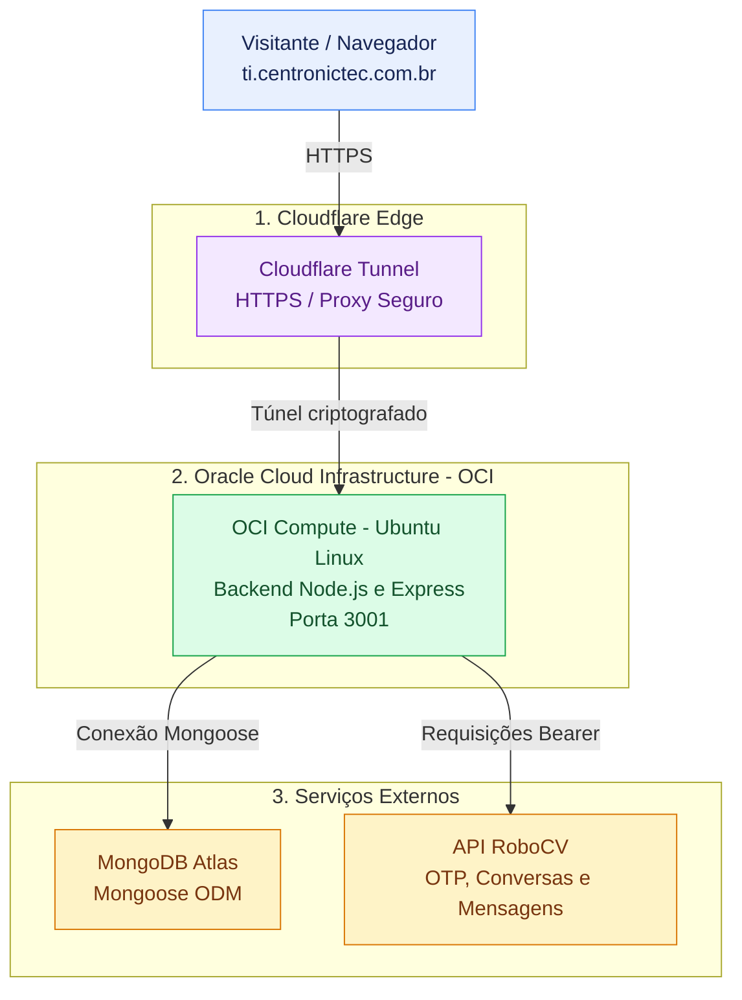

# TI Centronictec — Sistema Web Institucional e Atendimento Digital

## Sumário

- [Identificação Acadêmica](#identificação-acadêmica)
- [Descrição](#descrição)
- [Objetivos](#objetivos)
- [Arquitetura da Solução](#arquitetura-da-solução-multi-tenant)
  - [Diagrama da Arquitetura](#diagrama-da-arquitetura)
  - [Pontos Arquiteturais Chave](#pontos-arquiteturais-chave)
- [Desafios Arquiteturais: Por que não usamos a Vercel?](#desafios-arquiteturais-por-que-não-usamos-a-vercel)
- [Resiliência e Recuperação de Desastres](#resiliência-e-recuperação-de-desastres-migração-aws-para-oci)
- [Stack Tecnológica](#stack-tecnológica)
- [Tecnologias Utilizadas](#tecnologias-utilizadas)
- [Funcionalidades](#funcionalidades)
- [Modelagem do Banco de Dados](#modelagem-do-banco-de-dados)
- [Pré-requisitos](#pré-requisitos)
- [Instalação (Desenvolvimento)](#instalação-desenvolvimento)
- [Execução em Produção com PM2](#como-executar-produção-com-pm2)
- [Estrutura do Projeto](#estrutura-do-projeto)
- [Exemplos de Uso](#exemplos-de-uso)
- [API — Rotas Principais](#api--rotas-principais)
- [Equipe do Projeto](#equipe-do-projeto)
- [Melhorias Futuras](#melhorias-futuras)
- [Licença](#licença)
- [Status do Projeto](#status-do-projeto)

---

## Identificação Acadêmica

- **Instituição de Ensino:** SENAC — CEP Jó Rufino
- **Curso:** Técnico em Desenvolvimento de Sistemas
- **Disciplina / Projeto:** Sistema web TI Centronictec
- **Orientador:** Hudson Neves
- **Aluno:** Vanderli Marques dos Reis
- **Local & Ambiente:** Taguatinga Norte — Oracle Cloud Infrastructure (OCI)

---

## Descrição

O **TI Centronictec** é um sistema web institucional destinado a apresentar serviços de assistência e suporte em tecnologia, equipamentos, sistemas operacionais e infraestrutura de redes. O sistema oferece navegação por áreas de serviço, conteúdo institucional, apresentação visual responsiva e um canal de atendimento digital integrado à plataforma RoboCV.

---

## Objetivos

- **Objetivo geral:** Registrar de forma organizada e verificável as funcionalidades oferecidas, limites conhecidos, tecnologias utilizadas, interfaces e condições operacionais do produto web institucional.
- **Problema que o sistema resolve:** Fornecer uma interface unificada e responsiva para apresentação de portfólio de serviços de TI e captação de clientes por meio de um canal de chat seguro com validação de telefone via OTP.
- **Público-alvo:** Visitantes que acessam o site para conhecer a empresa e seus serviços, potenciais clientes que desejam solicitar avaliação ou orçamento, e operadores que dão continuidade aos atendimentos na plataforma RoboCV.

---

## Arquitetura da Solução (Multi-Tenant)

O sistema opera separando a camada de apresentação da integração de backend, comunicando-se com serviços de terceiros e persistência orientada a documentos.


### Diagrama da Arquitetura




### Pontos Arquiteturais Chave

- **Cloudflare Tunnel:** Utilizado para expor o serviço de forma segura em ambiente de produção na OCI.
- **Frontend em React Native Web:** Desenvolvido com o auxílio do Expo e Expo Router para roteamento e gerenciamento de telas adaptáveis.
- **Backend Node.js & Express:** Responsável pelas rotas de API em `/api` e `/api/chat`, emissão de tokens de sessão assinados (HMAC-SHA-256 com validade de 8 horas).
- **MongoDB Atlas / Mongoose:** Banco de dados orientado a documentos utilizado para persistência.

---

## Desafios Arquiteturais: Por que não usamos a Vercel?

A aplicação requer processos contínuos de backend para gerenciar conexões assíncronas, requisições HTTP seguras com chaves de API restritas (`Bearer Token`) e tratamento de rotas dedicadas em infraestrutura em nuvem na OCI, garantindo estabilidade e controle total sobre o tempo de resposta e o isolamento de dados.

---

## Resiliência e Recuperação de Desastres (Migração AWS para OCI)

A aplicação foi estruturada para rodar de maneira otimizada na **Oracle Cloud Infrastructure (OCI)**.
- **Isolamento de rede e segurança:** Uso de Cloudflare Tunnel, evitando exposição direta de portas da máquina virtual.
- **Recuperação rápida:** Estrutura modular desacoplada com persistência centralizada no MongoDB Atlas.
- **Resiliência operacional:** Gerenciamento de processos via PM2 para assegurar alta disponibilidade no ambiente de produção.

---

## Stack Tecnológica

A arquitetura do sistema divide-se em duas camadas principais:
- **Camada de Apresentação (Frontend):** Construída com React Native, React Native Web, Expo e Expo Router, permitindo adaptação responsiva com base em breakpoints de tela.
- **Camada de Aplicação (Backend):** Servidor desenvolvido em Node.js com Express, responsável por prover os endpoints de API, validações de entrada e comunicação com serviços externos.

---

## Tecnologias Utilizadas

| Categoria | Tecnologias |
|---|---|
| **Runtime e Backend** | Node.js, Express |
| **Frontend** | React Native, React Native Web, Expo, Expo Router |
| **Banco de dados** | MongoDB, Mongoose |
| **Segurança e Utilitários** | CORS, dotenv, HMAC-SHA-256 (tokens de sessão) |
| **Infraestrutura e Deploy** | Oracle Cloud Infrastructure (OCI), Cloudflare Tunnel, PM2 |

---

## Funcionalidades

- Apresentação da página institucional e carrossel de conteúdo responsivo com avanço automático.
- Catálogo de serviços de tecnologia com navegação por identificadores.
- Alternância entre tema claro e escuro com persistência local no navegador (`ThemeContext`).
- Painel de atendimento digital interativo com validação de telefone (10 a 13 dígitos) e código OTP de 6 dígitos via API RoboCV.
- Consulta e envio de mensagens autenticadas com atualização periódica a cada 7 segundos.
- Endpoint de verificação de saúde do sistema (`/api/health`).

---

## Modelagem do Banco de Dados

- **Coleções MongoDB:** Gerenciadas via Mongoose para persistência de dados de suporte e integração com as sessões de conversação gerenciadas pela plataforma RoboCV.

---

## Pré-requisitos

- Node.js (versão compatível com Express e dependências do projeto).
- Instância ou conta configurada no MongoDB Atlas (`MONGODB_URI`).
- Credenciais de acesso à API RoboCV (`ROBOCV_API_URL` e `ROBOCV_API_TOKEN`).
- Acesso à infraestrutura OCI e Cloudflare Tunnel para ambiente de produção.

---

## Instalação (Desenvolvimento)

### 1. Clone o repositório

```bash
git clone https://github.com/seu-usuario/ti-centronictec.git
```

### 2. Acesse o diretório do projeto

```bash
cd ti-centronictec
```

### 3. Instale as dependências

```bash
npm install
```

### 4. Configure as variáveis de ambiente

Crie o arquivo `.env` na raiz do projeto com base nas orientações de configuração (`MONGODB_URI`, `PORT`, `ROBOCV_API_URL`, `ROBOCV_API_TOKEN`).

### 5. Inicie a versão web para desenvolvimento

```bash
npm run build:web
```

---

## Como Executar (Produção com PM2)

Para manter o backend em execução contínua na OCI:

### Iniciar a aplicação

```bash
pm2 start server.js --name "ti-centronictec"
```

### Salvar o estado dos processos

```bash
pm2 save
```

---

## Estrutura do Projeto

Organização modular por responsabilidades:
- `server/` — Lógica de backend, rotas da API (`/api`, `/api/chat`), conexão Mongoose e middlewares.
- `src/` ou componentes de interface — Telas, componentes visuais, contextos de tema (`ThemeContext`) e rotas gerenciadas por Expo Router.
- `package.json` — Declaração de dependências (`package.json`) e scripts de build (`build:web`).

---

## Exemplos de Uso

- **Acesso institucional:** O usuário acessa `https://ti.centronictec.com.br`, navega pelo carrossel responsivo e consulta os serviços de TI disponíveis.
- **Atendimento digital:** O visitante abre o painel de chat, informa seu telefone, insere o código OTP de 6 dígitos recebido e inicia o atendimento autenticado com a plataforma RoboCV.

---

## API — Rotas Principais

| Método HTTP | Endpoint | Descrição |
|---|---|---|
| `GET` | `/api/health` | Informa o estado do servidor e da conexão Mongoose. |
| `POST` | `/api/chat/solicitar-codigo` | Solicita o envio de código OTP para o telefone informado. |
| `POST` | `/api/chat/confirmar-codigo` | Valida o código OTP de 6 dígitos. |
| `POST` | `/api/chat/iniciar` | Inicia a conversa na plataforma RoboCV após verificação de nome e telefone. |
| `GET` | `/api/chat/:id/mensagens` | Consulta as mensagens de uma conversa utilizando token de sessão válido. |

---

## Equipe do Projeto

- **Responsável / Aluno:** Vanderli Marques dos Reis
- **Orientador:** Profº Hudson Neves

---

## Melhorias Futuras

- Implementação de testes automatizados de unidade e integração.
- Ampliação da suíte de testes responsivos e de acessibilidade (WCAG).
- Publicação formal de Aviso de Privacidade em conformidade integral com a LGPD (Lei nº 13.709/2018).

---

## Licença

MIT License / ISC (conforme declaração em `package.json`)

Copyright (c) 2026 Vanderli Marques dos Reis

Permission is hereby granted, free of charge, to any person obtaining a copy
of this software and associated documentation files (the "Software"), to deal
in the Software without restriction, including without limitation the rights
to use, copy, modify, merge, publish, distribute, sublicense, and/or sell
copies of the Software, and to permit persons to whom the Software is
furnished to do so, subject to the following conditions:

The above copyright notice and this permission notice shall be included in all
copies or substantial portions of the Software.

THE SOFTWARE IS PROVIDED "AS IS", WITHOUT WARRANTY OF ANY KIND, EXPRESS OR
IMPLIED, INCLUDING BUT NOT LIMITED TO THE WARRANTIES OF MERCHANTABILITY,
FITNESS FOR A PARTICULAR PURPOSE AND NONINFRINGEMENT. IN NO EVENT SHALL THE
AUTHORS OR COPYRIGHT HOLDERS BE LIABLE FOR ANY CLAIM, DAMAGES OR OTHER
LIABILITY, WHETHER IN AN ACTION OF CONTRACT, TORT OR OTHERWISE, ARISING FROM,
OUT OF OR IN CONNECTION WITH THE SOFTWARE OR THE USE OR OTHER DEALINGS IN THE
SOFTWARE.

---

## Status do Projeto

**Situação:** Em desenvolvimento / Em fase de validação técnica e acadêmica.
